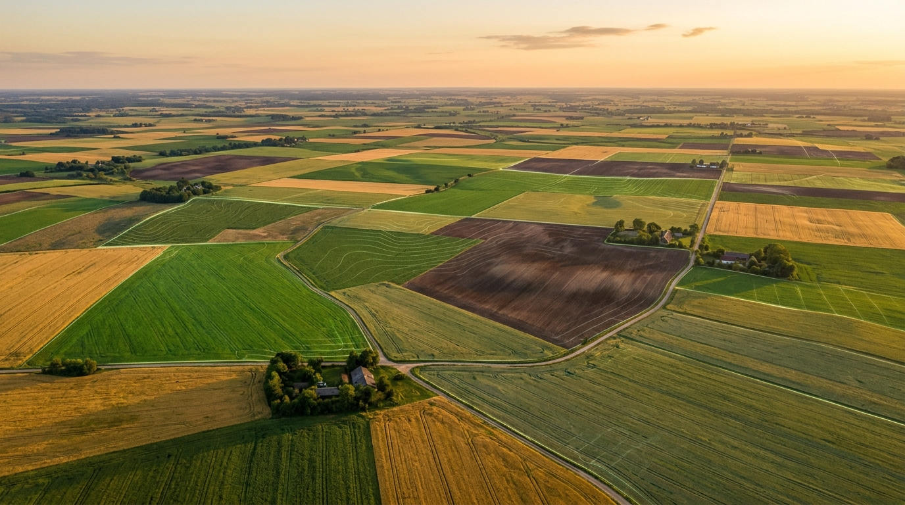
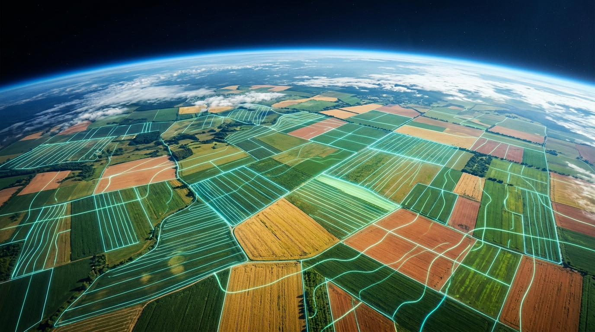
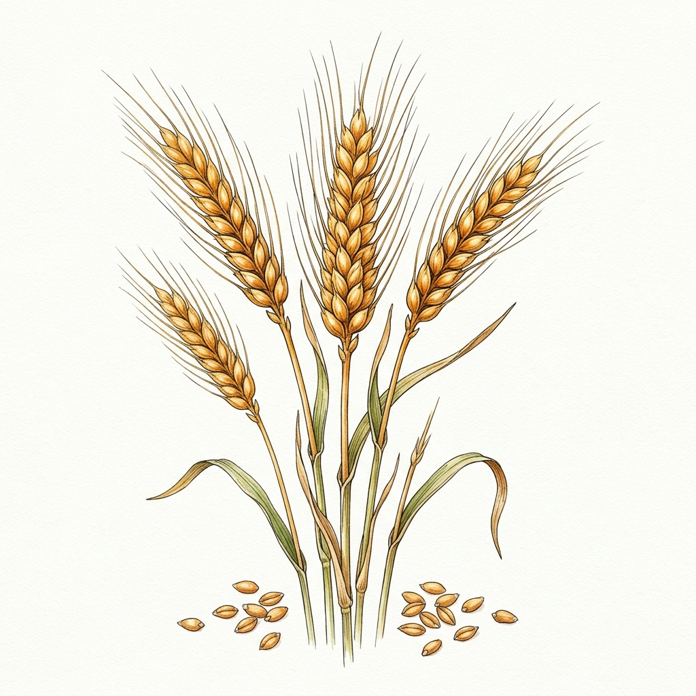
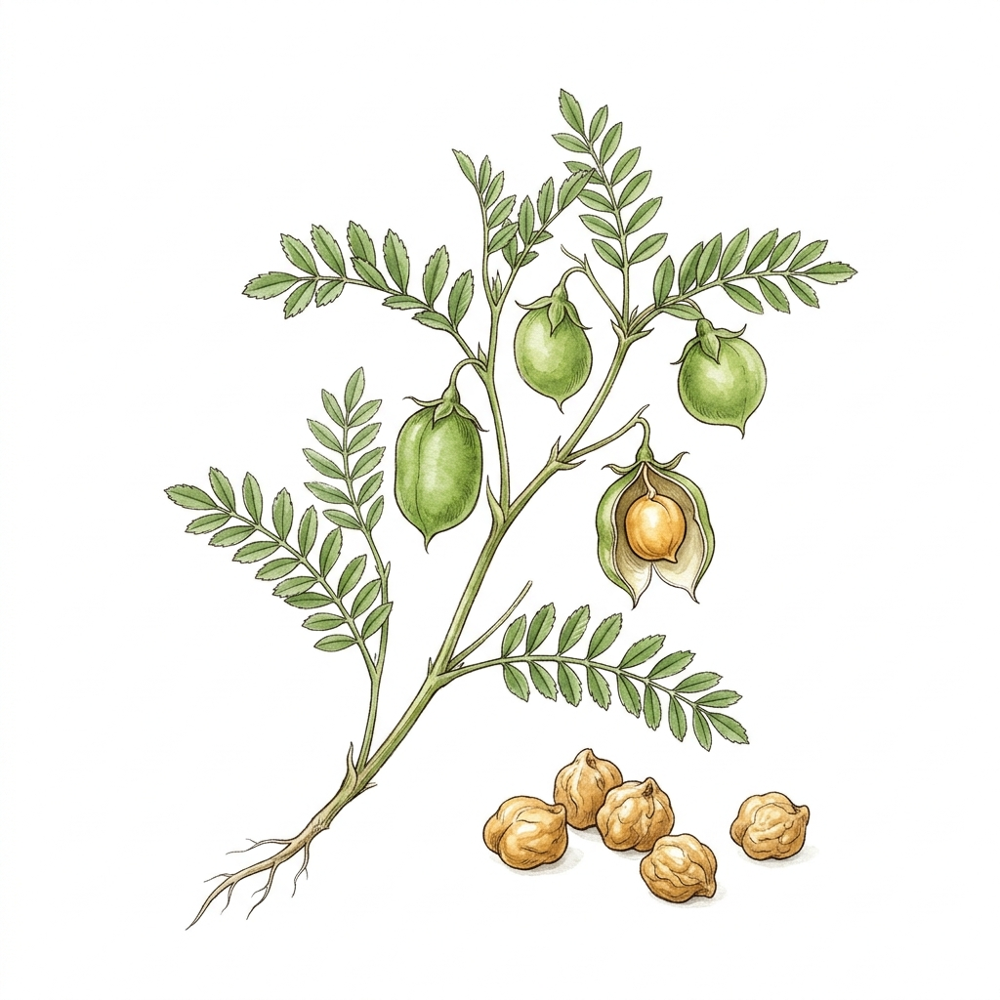
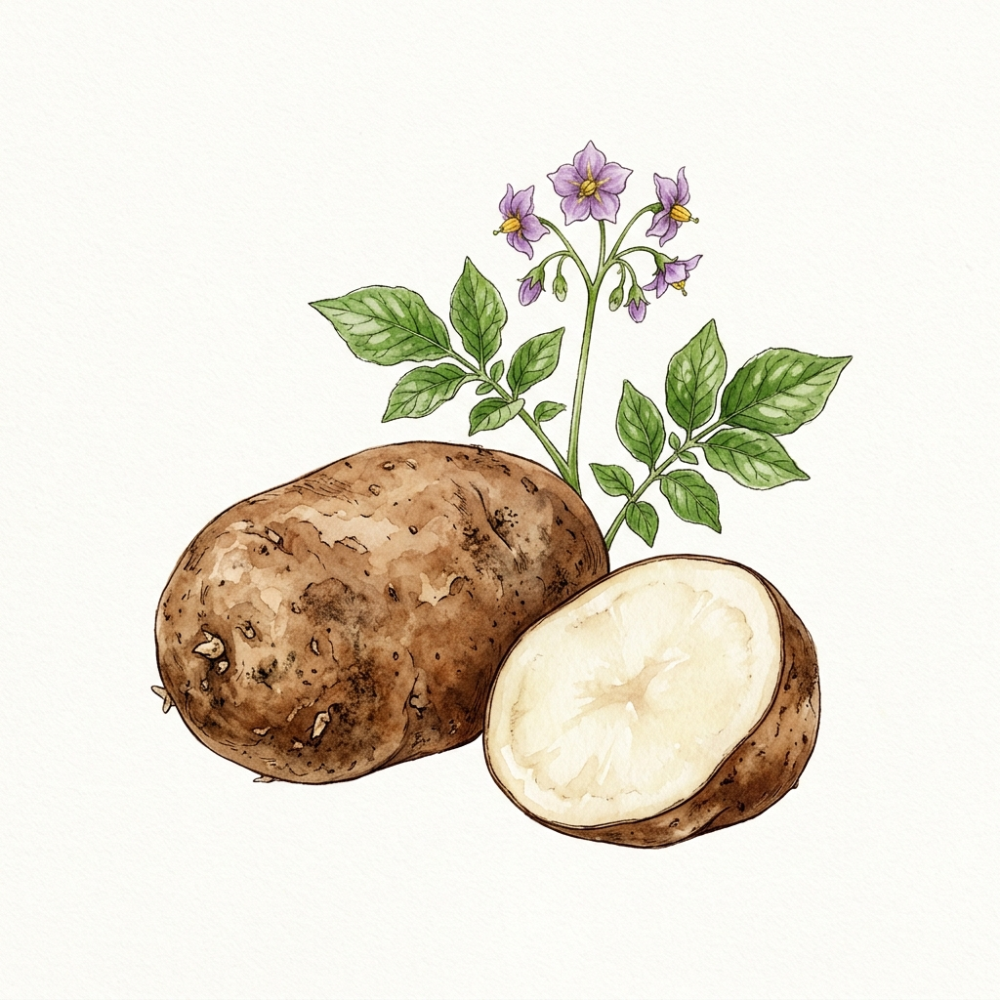
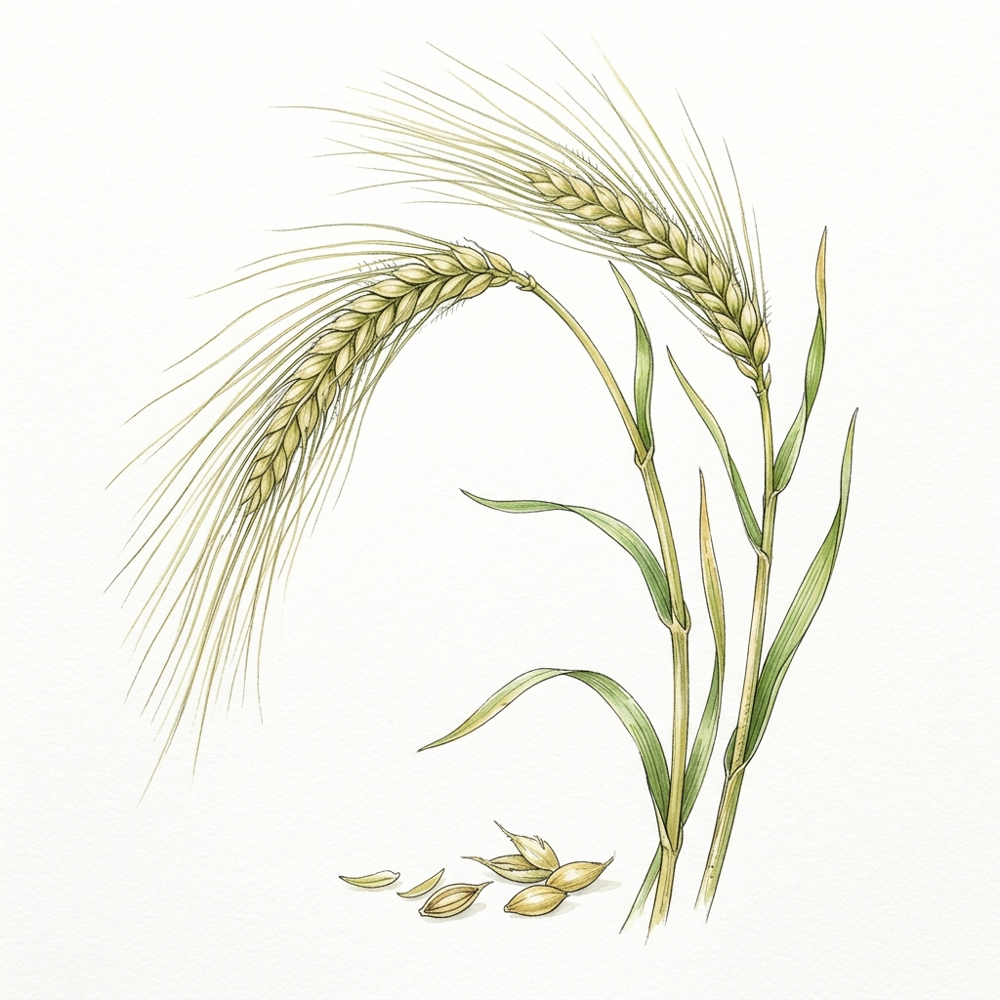
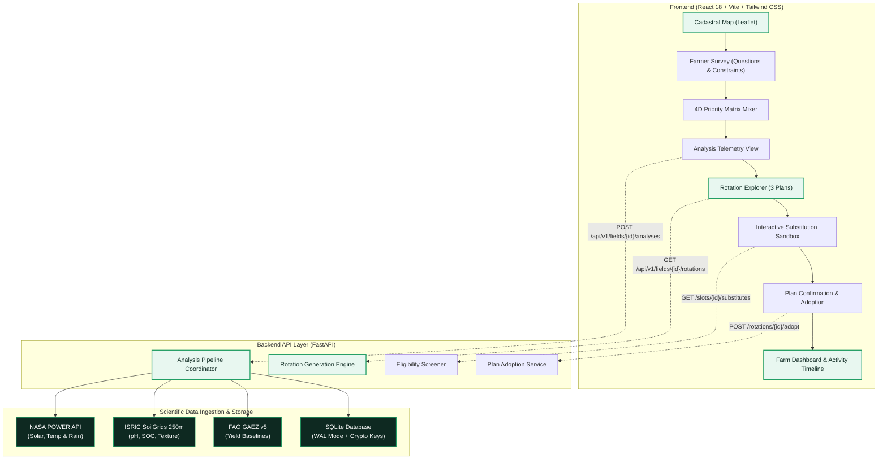

<div align="center">



# 🌾 Field Shift
### Earth Intelligence for Sustainable Multi-Year Crop Rotations

[](https://www.spaceappschallenge.org/2026/challenges/field-shift-adapting-farms-with-nasa-data/)
[](https://fastapi.tiangolo.com)
[](https://react.dev)
[](https://tailwindcss.com)
[-D9943B?style=for-the-badge)](#bilingual-support-english--arabic-rtl)
[](LICENSE)

**Field Shift** transforms satellite Earth observation baselines, local farm conditions, and farmer priorities into scientifically validated multi-year crop rotation plans.

[Key Features](#key-features) • [Scientific Integrity](#scientific-integrity--honest-data-charter) • [Architecture](#architecture) • [Getting Started](#quickstart-guide) • [Crop Succession Science](#botanical-diversity--crop-succession-science)

---

</div>

## 🌍 The Mission

Modern agriculture faces unprecedented climate volatility, water stress, and soil degradation. Continuous monocropping exhausts micronutrients and accelerates pest vulnerability, yet smallholder farmers often lack access to sophisticated agronomic decision support.

Built for the **NASA Space Apps Challenge 2026** (*"Field Shift: Adapting Farms with NASA Data"*), **Field Shift** bridges satellite Earth observation science and practical on-the-ground farm management. It translates global datasets into actionable, field-specific multi-year rotation sequences that conserve water, enrich soil organic matter, break biological pest cycles, and stabilize seasonal yields.

---

## 🚀 Key Features

### 🗺️ Cadastral Field Boundary Mapping
- Interactive Leaflet vector mapping with high-resolution satellite imagery (Esri World Imagery) and standard cartography.
- One-click boundary drawing and vertex editing on the **WGS84 ellipsoid** with geodesic area calculation in hectares.
- Global geographic search via OpenStreetMap Nominatim with quick-zoom agronomic presets (e.g., Meknès Valley, Gharb Basin, Taroudant, Nile Delta, Central Valley).

### 🛰️ Live Earth Observation Telemetry Pipeline
- Direct integration with **NASA POWER API** (Prediction of Worldwide Energy Resources): 30-year climatological solar radiation, monthly rainfall distribution, and temperature envelopes at 0.5° grid resolution.
- Integrated soil property analysis via **ISRIC SoilGrids 250m** machine-learning estimates: topsoil pH, soil organic carbon (SOC), sand/silt/clay texture fractions, and nitrogen content.
- Potential agro-ecological yield baseline ceilings referencing **FAO GAEZ v5** (Global Agro-Ecological Zones).

### ⚖️ Four-Dimensional Linked Priority Mixer
- Interactive priority balancing across four fundamental agricultural pillars:
  1. 💧 **Water Conservation Fit** — rainfed deficit tolerance, drought resilience, and moisture conservation.
  2. 🌱 **Soil Health & Regeneration** — legume nitrogen fixation, organic carbon retention, and pest break intervals.
  3. 🌾 **Attainable Yield Potential** — agro-ecological model suitability ceilings under regional conditions.
  4. 🛡️ **Climate Resilience** — resistance to seasonal temperature swings and erratic precipitation spikes.
- Linked slider controls ensure the total weight always equals exactly 100%, dynamically redistributing weights when observational data layers are missing.

### 🔄 Multi-Season Crop Succession Engine
- Generates up to three distinct, feasible multi-year rotation plans (e.g., *Recommended*, *Soil-Regenerative*, *Water-Conservative*).
- Validates crop succession rules across consecutive years: enforces crop family diversification, checks legume nitrogen-fixing requirements, and penalizes high-risk monoculture sequences.
- Transparent score breakdown with full evidence attribution, rule IDs, and explicit limitations.

### 🧪 Interactive Crop Substitution Sandbox
- Farmers can modify any year in the rotation sequence by selecting from scientifically eligible replacement crops.
- The engine recalculates feasibility in real-time, verifying whether the proposed substitution violates pest break intervals or climatic thresholds.
- Side-by-side comparison matrix showing metric deltas before and after modification.

### 🏡 Returning Farmer Command Center
- Permanent, private access without passwords using client-side cryptographic keys (`X-FieldShift-Access-Key`).
- **Cadastral Vector Boundary Thumbnail**: High-resolution vector polygon rendering of the farmer's parcel over satellite imagery.
- **Monthly Precipitation Distribution**: Interactive weighted monthly rainfall histogram derived from NASA POWER 30-year baselines.
- **Chronological Crop Timeline**: Multi-year field activities tracker logging planting, maintenance, and harvesting milestones.

---

<div align="center">



</div>

---

## 🌿 Botanical Diversity & Crop Succession Science

Field Shift evaluates a curated portfolio of field crops across diverse botanical families to construct balanced, resilient succession sequences:

| Crop | Botanical Family | Agronomic Role | Key Trait |
|---|---|---|---|
| <br>**Bread Wheat** | *Poaceae* (Cereal) | Primary staple, soil surface biomass | Fibrous root system, carbon input |
| <br>**Chickpea** | *Fabaceae* (Legume) | Biological Nitrogen ($N_2$) Fixer | Rhizobia nodulation, reduces synthetic fertilizer demand |
| <br>**Lentil** | *Fabaceae* (Legume) | High water-use efficiency | Short growing cycle, moisture conservation |
| <br>**Sunflower** | *Asteraceae* (Oilseed) | Deep nutrient scavenging | Deep taproot structure, breaks subsoil compaction |
| <br>**Potato** | *Solanaceae* (Tuber) | High caloric yield | Deep root-zone tillage, pest cycle disruption |
| <br>**Barley** | *Poaceae* (Cereal) | Salinity & drought tolerance | Early ground cover, weed suppression |

### Principles of Balanced Succession:
1. **Biological Nitrogen Fixation**: Integrating legumes (Chickpea, Lentil, Faba Bean) fixes atmospheric nitrogen into the soil, replenishing reserves depleted by preceding cereal crops.
2. **Pest & Pathogen Break Intervals**: Alternating botanical families prevents the buildup of soil-borne pathogens (such as *Fusarium* wilt or cereal cyst nematodes).
3. **Root Architecture Complementarity**: Alternating shallow fibrous root systems (Wheat, Barley) with deep taproots (Sunflower, Safflower) optimizes moisture extraction across distinct soil depths.

---

## 🏛️ Architecture & Data Flow



---

## 🛡️ Scientific Integrity & Honest Data Charter

Field Shift operates under a strict **Honest Science Charter**:

* ❌ **No Hallucinated Predictions**: We never fabricate profit forecasts, monetary yields, or speculative percentage gains.
* 🏷️ **Explicit Provenance Labels**: Every observational data point in the UI carries its exact provenance — **Live**, **Cached** (with ISO timestamp), or **Unavailable**.
* ⚖️ **Dynamic Weight Redistribution**: If a scientific data layer is unavailable (e.g., SoilGrids downtime), its weight is transparently redistributed among the active indicators rather than injecting synthetic dummy values.
* 🔒 **Zero-Knowledge Anonymous Keys**: No passwords or personal accounts. Browser storage generates an anonymous cryptographic key (`crypto.getRandomValues`); the backend persists only its one-way SHA-256 hash.

---

## 🌐 Bilingual Support (English & Arabic RTL)

Field Shift features complete, bidirectional internationalization:
- **Arabic (العربية)**: Full Right-to-Left (RTL) layout switching, tailored Cairo typography, and localized crop nomenclature.
- **English**: Left-to-Right (LTR) default with Plus Jakarta Sans and JetBrains Mono typography.
- Persistent language state preserved in browser storage with instant toggle from any header or footer.

---

## ⚡ Quickstart Guide

### Prerequisites
- **Python**: 3.11 or higher
- **Node.js**: 20 or higher
- **npm**: 10 or higher

### 1. Clone the Repository
```bash
git clone https://github.com/zakaria1n/field-shift.git
cd field-shift
```

### 2. Launch Backend (FastAPI)
```bash
cd backend
python -m pip install -r requirements.txt
python -m uvicorn app.main:app --reload --port 8000
```
* Interactive API Documentation (Swagger UI): `http://127.0.0.1:8000/docs`

### 3. Launch Frontend (React + Vite)
```bash
cd ../frontend
npm install
npm run dev
```
* Application URL: `http://localhost:5173`

> [!TIP]
> **Pre-configured Demo Farm**: To immediately explore an active farm with vector boundaries, an adopted 3-year rotation plan, and scientific observations without running through the wizard, set your browser's `localStorage` item `fieldshift.access_key` to `fsk_demouser`.

---

## 🧪 Testing & Verification

Field Shift includes automated test suites across both layers:

```bash
# Backend Test Suite (39 pytest unit and integration tests)
cd backend
python -m pytest tests/ -v

# Frontend Test Suite (13 Vitest unit and component tests)
cd frontend
npm test
```

---

## 📜 Citations & Open Data Attribution

- **NASA POWER Project**: Climatology API (Solar Radiation, Precipitation, Temperature Bands) — [power.larc.nasa.gov](https://power.larc.nasa.gov/)
- **ISRIC — World Soil Information**: SoilGrids 250m Global Digital Soil Mapping — [soilgrids.org](https://soilgrids.org/)
- **FAO & IIASA**: Global Agro-Ecological Zones (GAEZ v5) — [gaez.fao.org](https://gaez.fao.org/)
- **Cartography & Maps**: © OpenStreetMap contributors, Nominatim Geocoding; Satellite Imagery © Esri.

*Disclaimer: Uses NASA open data. This is an independent hackathon project developed for the NASA Space Apps Challenge 2026 and is not officially endorsed by NASA.*

---

<div align="center">

Crafted with care for **NASA Space Apps Challenge 2026** 🌱

</div>
